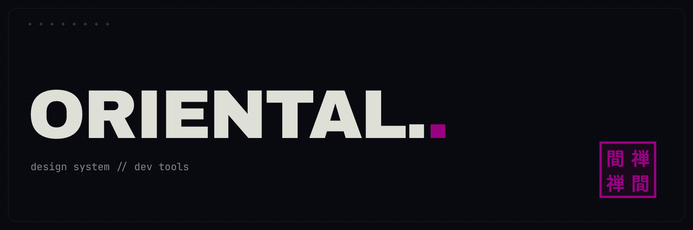
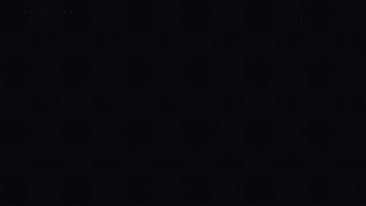
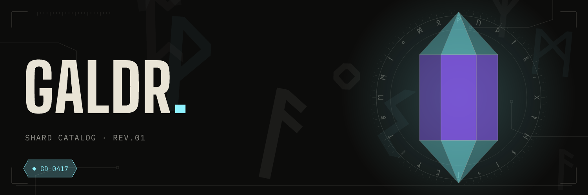
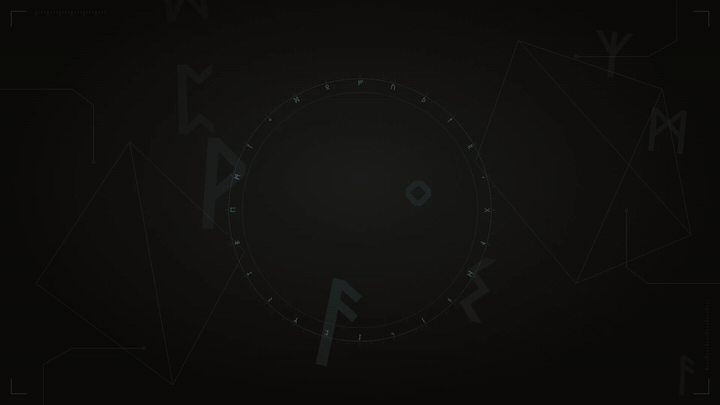
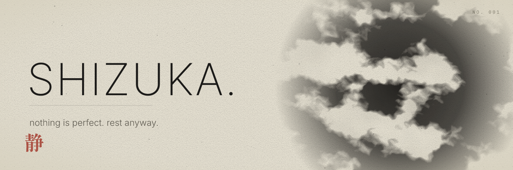
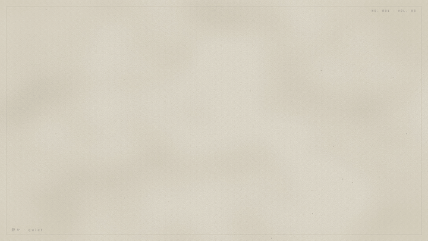

# art-concept

Three art concepts, each with **one master reference**, a library of **144 prompts**, guides, tokens, ready-made CSS components, an example page, script-made assets and animated Remotion demos.

| Concept | Mood | Primary (identity) | Master reference |
|---|---|---|---|
| **Oriental Brutalismo** | dark, editorial, dry | magenta `#980281` | [`ORIENTAL BRUTALISMO.md`](oriental-brutalismo/ORIENTAL%20BRUTALISMO.md) |
| **Galdr** | dark, primitive Nordic cyberpunk, minimal | ice `#8FF3FF` | [`GALDR.md`](galdr/GALDR.md) |
| **Shizuka** | aged paper, ink, calm and strange | shu `#A8473A` (the kanji) | [`SHIZUKA.md`](shizuka/SHIZUKA.md) |

## Preview

### Oriental Brutalismo





[Full quality video (mp4)](media/oriental-intro.mp4)

### Galdr





[Full quality video (mp4)](media/galdr-intro.mp4)

### Shizuka





[Full quality video (mp4)](media/shizuka-intro.mp4)

## Two rules that apply to all three

1. **Every piece of art depends on one primary color.** Changing `--color-primary` (CSS), `primary` (Remotion) or `--primary` (scripts) changes the whole art. The contrast of each variation is computed in `docs/10` of every concept. Use of a primary color is free; the primary of Oriental Brutalismo is `#980281` (magenta).
2. **Own black and white.** Never `#000000` or `#FFFFFF`: each concept has its own tinted black and white (`color.black`, `color.white`).

## Structure

```
art-concept/
├── <concept>/
│   ├── <NAME>.md          master reference (22 sections + master prompt for AI)
│   ├── PROMPTS.md         144 prompts: image, icons, banners, people, editing, video, audio, text, code
│   ├── README.md          index
│   ├── docs/              guides 01…14 (+15 in Oriental)
│   ├── tokens/            tokens.json · tokens.css · components.css
│   ├── examples/          showcase.html (components + live primary swap)
│   └── reference/         source images and MDs
├── src/                   Remotion: 20 compositions + utilities (shared/)
├── tools/                 make-asset · get-fonts · build-tokens · build-prompts · build-docs · shot
└── docs/                  concept comparison and workflow
```

`tokens.json` is the single source. Remotion, the asset generator, the CSS and docs 10–14 all derive from it.

## Getting started

```bash
npm install
npm run studio                                # 20 compositions in 3 folders, with a props panel (primary)
npm run fonts                                 # downloads the TTFs (for faithful PNGs)
npm run assets                                # 24 assets (SVG+PNG) in out/assets
npm run typecheck
```

The files in `media/` are the intro videos (`npx remotion render src/index.ts <Concept>-Intro media/<concept>-intro.mp4`) and the banners (`node tools/make-asset.mjs --concept <concept> --type banner --png`).

Node 20+ (tested with v26). Remotion downloads a headless Chrome on the first render.

## Remotion compositions (30 fps)

| Concept | Ids |
|---|---|
| Oriental | `Oriental-Intro` · `-Ui` · `-Components` · `-Logo` · `-Banner` (1500×500) · `-Social` (1080×1350) |
| Galdr | `Galdr-Intro` · `-Ui` · `-Components` · `-Kit` · `-Logo` · `-Mobile` (1080×1920) · `-Social` (1080×1350) |
| Shizuka | `Shizuka-Intro` · `-Ui` · `-Focus` · `-Components` · `-Logo` · `-Social` (1080×1350) · `-Kanji` |

Each concept has **its own motion language**: Oriental is dry (wipes, kanji with shake), Galdr is precise and luminous (diagonal wipes, light sweep, turning crystal and rune ring), Shizuka is slow (blur→sharp, ink bloom spreading, numbers fading, kanji appearing).

```bash
npx remotion still  src/index.ts Galdr-Intro out/g.png --frame=120
npx remotion render src/index.ts Shizuka-Social out/s.mp4 --props='{"primary":"#2F3F6B","quote":"breathe."}'
```

## Assets

```bash
node tools/make-asset.mjs --concept <oriental-brutalismo|galdr|shizuka> \
  --type <icon|badge|banner|wallpaper|og|social|avatar|pattern> \
  [--title T] [--subtitle S] [--glyph G] [--primary #rrggbb] [--size 1500x500] [--png] [--out dir]
```

## Regenerating what is generated

| Command | Generates |
|---|---|
| `node tools/build-tokens.mjs` | each concept's `tokens.css` |
| `node tools/build-prompts.mjs` | each concept's `PROMPTS.md` (edit `tools/prompt-data.mjs`) |
| `node tools/build-docs.mjs` | each concept's `docs/10…14` (+15) |
| `node tools/shot.mjs <concept> out/x.png` | screenshot of `examples/showcase.html` |

## Adding a fourth concept

1. Copy a concept folder and edit `tokens/tokens.json` (include `primary`, `black`, `white`, `onPrimary`).
2. In `tools/templates.mjs`, `tools/prompt-data.mjs` and `tools/build-docs.mjs`, add the concept data.
3. In `src/<new>/`, create `theme.tsx` and the compositions; register them in `src/Root.tsx` with `defaultProps.primary`.
4. Write the master reference following the 22 sections.
5. Run the generators above.

## License and credit

- **Code** (`src/`, `tools/`): [MIT](LICENSE).
- **Art concepts, docs, tokens, prompts, CSS components and examples**: [CC BY 4.0](LICENSE-ART). You may use and adapt them, including commercially, **as long as you credit Eduardo Sato (Panda) — https://github.com/satodu — and say if you changed anything.**
- **Fonts** are not included (`npm run fonts` downloads them) and keep their own licenses (SIL OFL).
- **Reference images** (`*/reference/`) are AI-generated, are not part of this repository and are not covered by these licenses.

Suggested credit line: `Art concept by Eduardo Sato (Panda) — github.com/satodu/panda-concept-art, CC BY 4.0`.
